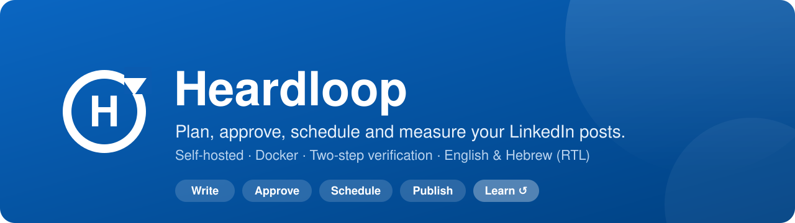
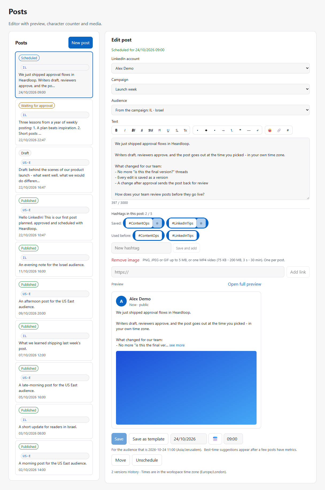
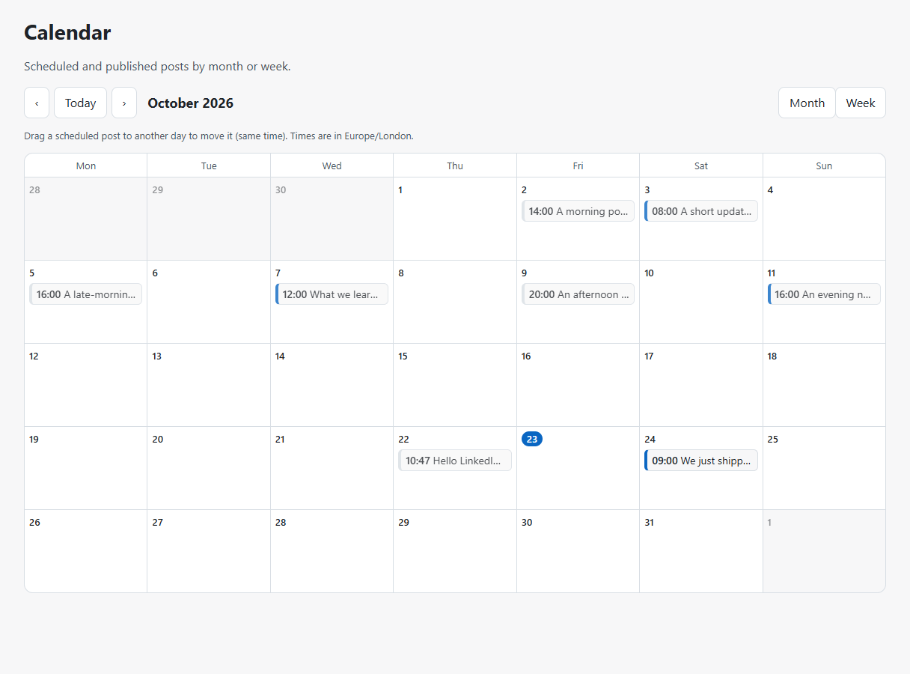
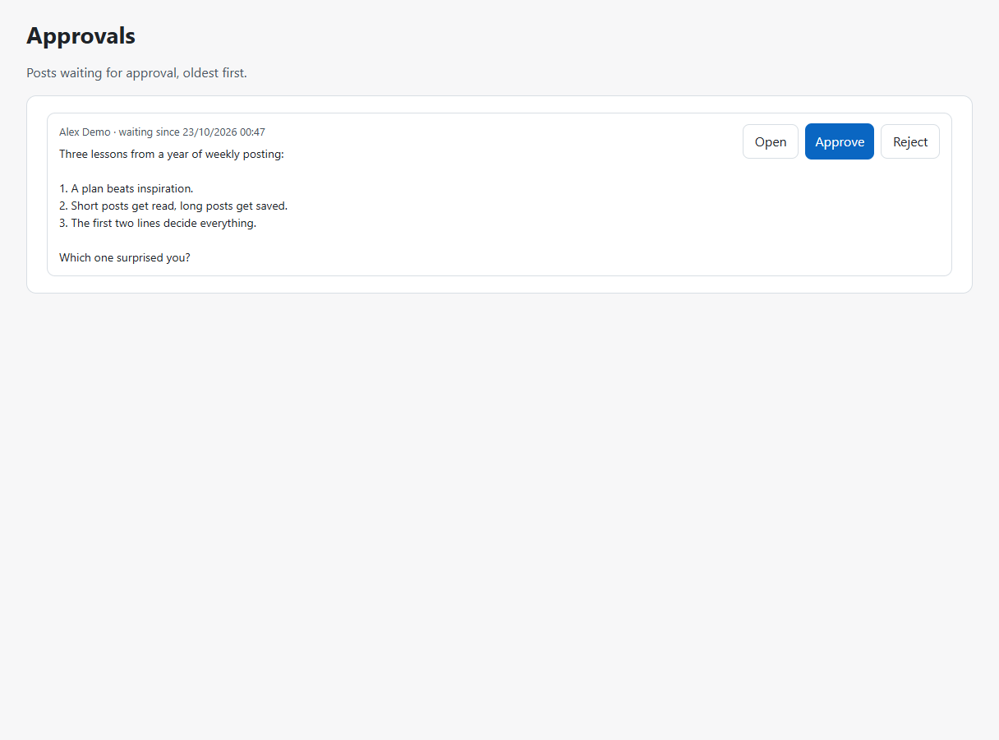
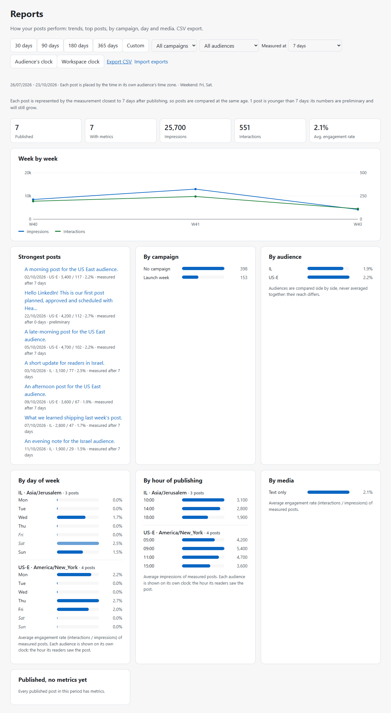
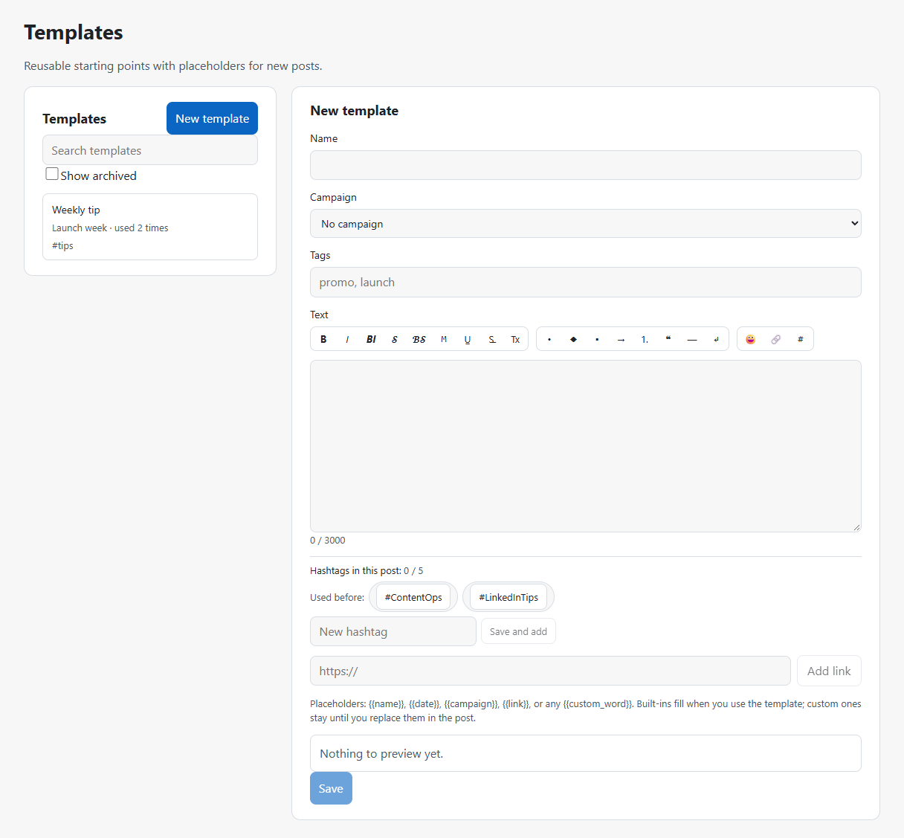
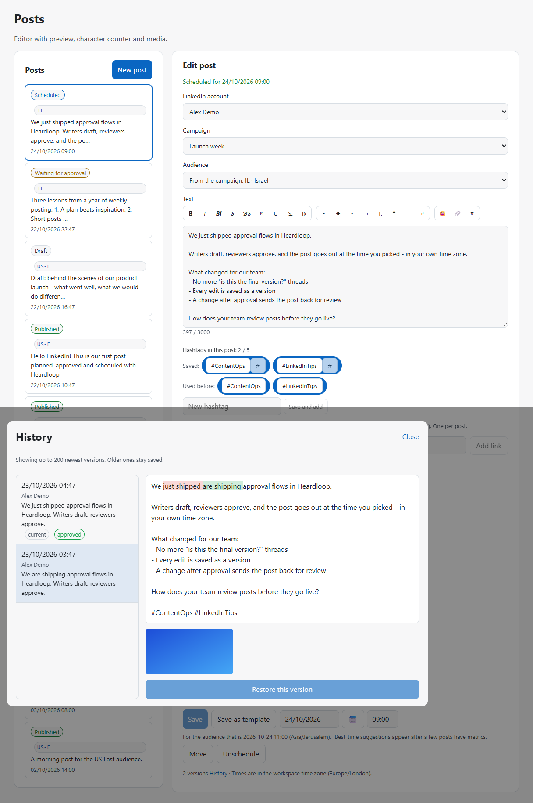
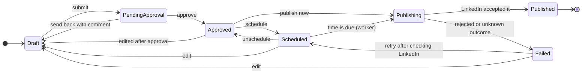
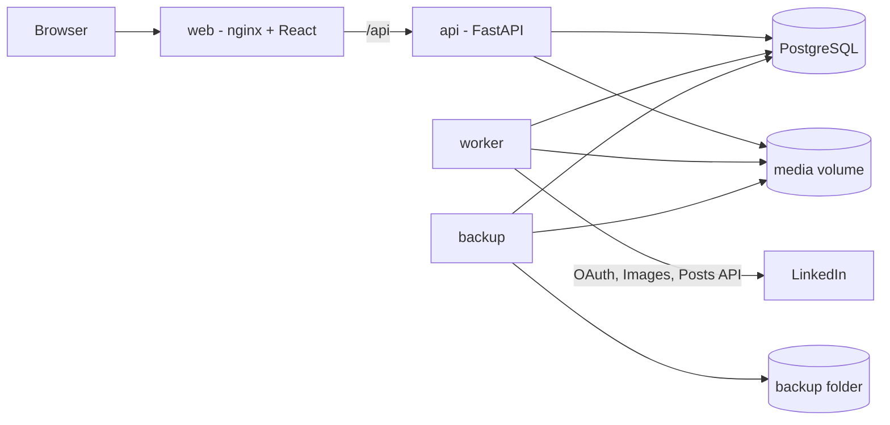

<p align="center">
  
</p>

<p align="center">
  <a href="https://github.com/HirezRa/heardloop/actions/workflows/ci.yml"></a>
  <a href="https://github.com/HirezRa/heardloop/releases"></a>
  
  
  
  
  
  <a href="LICENSE"></a>
</p>

<p align="center">
  <b>Write it. Get it approved. Post it on time. Learn what worked.</b><br>
  A self-hosted workspace for planning and publishing LinkedIn posts - with a real approval flow,
  reliable scheduling and security you can read in the code.
</p>

<p align="center">
  <a href="docs/INSTALL.md">Install guide</a> ·
  <a href="docs/GUIDE.md">User guide</a> ·
  <a href="https://github.com/HirezRa/heardloop/releases">Releases</a> ·
  <a href="CHANGELOG.md">Changelog</a> ·
  <a href="examples/n8n/README.md">n8n example</a>
</p>

---

## Why Heardloop?

Most LinkedIn content lives in documents, chats and reminders: drafts get lost, nobody knows what was approved,
and posting "at 8:00 tomorrow" depends on someone remembering. Heardloop puts the whole loop in one place:

- **One place for every post** - drafts, versions, comments from reviewers and the final published link.
- **Approval that means something** - editors write, approvers approve, and any change after approval sends the
  post back to draft automatically.
- **Scheduling you can trust** - a worker publishes on time, never twice, and tells you clearly when something
  went wrong instead of retrying blindly.
- **Your data stays with you** - runs on your own machine or server with Docker. No third-party SaaS in between.

### What it is / is not

- **It is** a self-hosted planner for your own LinkedIn profile: draft, approve, schedule, publish, measure.
- **It does not** scrape LinkedIn, auto-generate posts, like, comment or message on your behalf.
- **It does not** need a LinkedIn partner program — it uses the self-serve developer products.

## Features

| | Feature | Status |
| --- | --- | --- |
| ✍️ | Post editor: LinkedIn-style preview (desktop/phone), Unicode bold/italic and more, bullets, emoji, hashtag library with 3-5 counter, link cards with auto-filled title | ✅ |
| 🖼️ | One image (Images API) or one MP4 video up to 200 MB (Videos API, chunked upload) per post | ✅ |
| ✅ | Approval flow: submit, approve, send back with a comment; every edit saved as a version | ✅ |
| ⏰ | Schedule in the workspace time zone (DST-safe) or publish now ([LinkedIn's terms](#linkedins-terms)) | ✅ |
| 🔗 | Connect a LinkedIn profile with OAuth; token expiry tracking and reconnect reminder | ✅ |
| 👥 | Workspaces and roles: owner, editor, approver, viewer | ✅ |
| 🔐 | Argon2id passwords, account lockout, TOTP two-step verification with recovery codes | ✅ |
| 📜 | Activity log of every important action | ✅ |
| 🌍 | English or Hebrew (right-to-left) interface; per-user language, date/time format, text size, light/dark theme and accent colour | ✅ |
| 📅 | Calendar (month/week) with drag-and-drop rescheduling | ✅ |
| 🎯 | Campaigns with goal, dates, tags, color and per-status summary; approval queue | ✅ |
| 📋 | Templates with placeholders (`{{name}}`, `{{date}}`, …) for starting new posts | ✅ |
| 🕘 | Version history with word-level diff and restore | ✅ |
| 🔔 | Notifications in the app and by e-mail (SMTP), weekly digest, plus a signed webhook for n8n/Zapier ([docs](docs/WEBHOOKS.md)) | ✅ |
| 🔌 | n8n example workflow ([examples/n8n](examples/n8n/README.md)) | ✅ |
| 📈 | Post metrics (entered from LinkedIn's numbers), reports by week, campaign, audience, weekday and media at the same measurement age, CSV export, weekly digest | ✅ |
| 🌐 | Audiences: markets with their own time zone and weekend, so reports and best-time suggestions compare like with like, at the same measurement age | ✅ |
| 📥 | Import LinkedIn analytics exports (.xlsx): numbers and audience per post, one file or many, posts created on the fly | ✅ |
| 💾 | Nightly backups with verified restore: database and media, retention, optional AES-256 encryption, staleness alert ([guide](docs/GUIDE.md#10-backups-and-restore)) | ✅ |
| ✨ | AI writing assistant (optional, self-hosted OpenAI-compatible model such as Ollama) and best-time suggestions from your own metrics | ✅ |

## Screenshots

<!-- Generated from a demo stack with fictional data: see docs/DEMO.md -->

| | |
| --- | --- |
| <br><sub>Post editor with LinkedIn-style preview</sub> | <br><sub>Calendar month with scheduled posts</sub> |
| <br><sub>Approvals queue for reviewers</sub> | <br><sub>Reports by audience, with each market on its own clock</sub> |
| <br><sub>Reusable post templates</sub> | <br><sub>Version history with word-level diff</sub> |

## How it works

A post moves through a small, strict life cycle. Every arrow is checked on the server.



When a workspace turns approval off, drafts can be scheduled or published directly.

Under the hood it is a small stack you can run on a laptop:



- The **worker** claims due posts with `SELECT ... FOR UPDATE SKIP LOCKED` and a lease, so a post is published
  once even if two workers run. No message broker needed.
- An attempt is recorded **before** calling LinkedIn. If the outcome is unknown (timeout, broken connection),
  the post is marked failed with a clear reason instead of being retried - you will never see it posted twice.
- Only "safe" errors are retried (rate limits, LinkedIn temporarily unavailable, failures before the post exists).

## Quick start

Full step-by-step guide: [docs/INSTALL.md](docs/INSTALL.md)
(Hebrew: [docs/he/INSTALL.md](docs/he/INSTALL.md))

Requirements: Docker (Desktop) and a LinkedIn developer app (free).

```powershell
# 1. Secrets (once): creates .env with a random database password and encryption key
powershell -ExecutionPolicy Bypass -File scripts/new-env.ps1

# 2. Start everything
docker compose up -d --build

# 3. First account (once): owner + workspace. Asks for the password, never echoes it.
# Optional: --time-zone Europe/London (default: host local zone if detectable, else UTC)
docker compose exec api python -m heardloop.devtools.create_owner --email <your-email> --name "<your name>" --workspace "<workspace name>"
```

Open **http://localhost:8380**, sign in, turn on two-step verification (Settings) and connect LinkedIn (Accounts).
There is no public sign-up: the owner adds other users in Settings -> Members.

**LinkedIn developer app (summary):** create an app at https://www.linkedin.com/developers/apps, add the
products "Sign In with LinkedIn using OpenID Connect" and "Share on LinkedIn", set the redirect URL to
`http://localhost:8380/api/v1/linkedin/callback`, then put the Client ID and Secret in `.env`. Full steps
with screenshots: [INSTALL §4](docs/INSTALL.md#4-create-the-linkedin-developer-app).

### Documentation map

| Doc | What it covers |
| --- | --- |
| [INSTALL.md](docs/INSTALL.md) / [he/INSTALL.md](docs/he/INSTALL.md) | Install from zero, LinkedIn app, first login |
| [GUIDE.md](docs/GUIDE.md) | Everyday use: posts, approvals, metrics, backups |
| [WEBHOOKS.md](docs/WEBHOOKS.md) | Signed webhook payloads and verification |
| [n8n example](examples/n8n/README.md) / [he/n8n.md](docs/he/n8n.md) | Importable n8n workflow |
| [SPEC.md](docs/SPEC.md) | Design decisions the code depends on |
| [DEMO.md](docs/DEMO.md) | Demo stack for README screenshots |
| [CHANGELOG.md](CHANGELOG.md) | What changed in each release |
| [SECURITY.md](SECURITY.md) | How to report vulnerabilities |

## Updating

On the host, after a backup, run `scripts/update.ps1` (Windows) or `scripts/update.sh` (Linux/macOS). The
script backs up, rebuilds the stack and checks health. Full steps: [INSTALL §11](docs/INSTALL.md#11-backups-and-updates).

## Configuration

All settings live in `.env` (git-ignored). `.env.example` lists them all.

| Variable | Default | Purpose |
| --- | --- | --- |
| `POSTGRES_PASSWORD` | generated | Database password |
| `HEARDLOOP_TOKEN_KEY` | generated | AES-256-GCM key for stored tokens and secrets. **Back it up**; the app refuses to start if it changes |
| `LINKEDIN_CLIENT_ID` / `LINKEDIN_CLIENT_SECRET` | - | Your LinkedIn app |
| `LINKEDIN_REDIRECT_URI` | `http://localhost:8380/api/v1/linkedin/callback` | Must match the LinkedIn app |
| `LINKEDIN_API_VERSION` | empty = pinned in code | LinkedIn monthly API version (`YYYYMM`) |
| `UI_LANGUAGE` | `en` | `en` or `he` (Hebrew, right-to-left) |
| `APP_BASE_URL` | `http://localhost:8380` | Used for links in e-mails and webhook payloads |
| `SMTP_HOST` / `SMTP_PORT` / `SMTP_USERNAME` / `SMTP_PASSWORD` / `SMTP_FROM` / `SMTP_SECURITY` | empty / `587` / - / - / - / `starttls` | Optional e-mail notifications. Empty `SMTP_HOST` = in-app only |
| `APP_ENV` | `production` | `development` enables the API docs at `/api/docs` (reach it with the dev compose file, see Development) |
| `LOG_LEVEL` | `INFO` | API and worker log level |
| `COOKIE_SECURE` | `true` | Keep `true`; browsers accept secure cookies on `localhost` |
| `SESSION_IDLE_HOURS` / `SESSION_ABSOLUTE_DAYS` | `12` / `7` | Sign-in session idle timeout (hours) and absolute lifetime (days) |
| `WORKER_POLL_SECONDS` | `15` | How often the worker looks for due posts |
| `UPDATE_CHECK` / `UPDATE_CHECK_REPO` | `true` / `HirezRa/heardloop` | Optional notice when a newer GitHub release exists (never installs from the app) |
| `AUDIT_IP_RETENTION_DAYS` | `0` | Clear IP addresses from activity-log entries older than this many days (0 = keep until purged) |
| `AI_BASE_URL` / `AI_MODEL` / `AI_API_KEY` / `AI_TIMEOUT_SECONDS` | empty / empty / empty / `60` | Optional AI writing assistant: an OpenAI-compatible server, e.g. `http://ollama:11434/v1` ([INSTALL §13](docs/INSTALL.md#13-optional-ai-writing-assistant)). Post text is sent there when the assistant is used |
| `BACKUP_DIR` | `./backups` | Host folder for the nightly backup files (git-ignored) |
| `BACKUP_HOUR_UTC` | `01` | Hour (UTC, 0-23) of the nightly backup |
| `BACKUP_KEEP_DAYS` / `BACKUP_KEEP_MIN` | `30` / `7` | Delete sets older than this many days, but always keep at least this many good ones |
| `BACKUP_PASSPHRASE` | empty | Optional. If set, backups are encrypted and useless without it; store it with `HEARDLOOP_TOKEN_KEY` |

Personal overrides (other ports, bind mounts) go in `docker-compose.override.yml`, which is git-ignored.

## Security

Security is a feature here, not an afterthought:

- **Accounts**: Argon2id password hashing, lockout after 5 failures, TOTP two-step verification (required for
  owners), one-time recovery codes stored as keyed hashes.
- **Sessions**: server-side, HttpOnly + Secure + SameSite cookies, CSRF token on every change, new session token
  after the second factor.
- **Authorization**: checked on every endpoint; other workspaces' data returns 404, not 403.
- **Secrets**: LinkedIn tokens and TOTP secrets encrypted at rest (AES-256-GCM, bound to their record); a key
  fingerprint guard stops the app if the key changes.
- **Backups**: a nightly, verified backup of the database and media (optionally AES-256 encrypted) is written
  to a folder you choose; `.env` is never included, so back up `HEARDLOOP_TOKEN_KEY` yourself, and copy the
  backup folder off the machine ([guide](docs/GUIDE.md#10-backups-and-restore)).
- **Uploads**: images (PNG, JPEG, GIF) and MP4 video checked by content, size-limited, stored under
  random names; analytics imports (`.xlsx`) parsed with the standard library only and never stored.
- **Network**: only the web container publishes a port (loopback). The API and database are reachable from
  inside the Docker network only; containers run with all Linux capabilities dropped.
- **Supply chain & privacy**: pinned dependencies, Dependabot, a dependency vulnerability audit (`pip-audit`),
  gitleaks and a personal-data scan on every commit and in CI.

### Exposing Heardloop beyond localhost

The stack is built for `http://localhost:8380`. To reach it from other machines, put a TLS-terminating reverse
proxy in front of the web container and keep these in place:

- Serve it over **https only** and send `Strict-Transport-Security` from the proxy (for example
  `max-age=31536000`). Do not publish the web port on a public interface without TLS.
- Set `APP_BASE_URL` (and `LINKEDIN_REDIRECT_URI`) to the https address.
- Keep `COOKIE_SECURE=true`: the session cookie then uses the `__Host-` prefix, which only works over https.
- If another proxy sits in front of the web container, tell nginx the real client address
  (`set_real_ip_from <proxy network>;` and `real_ip_header X-Forwarded-For;` in `src/frontend/nginx.conf`),
  otherwise the login rate limit counts every user as the proxy.
- Never publish the API (`docker-compose.dev.yml`) or the database port on a server.

Found a vulnerability? Please follow [SECURITY.md](SECURITY.md) instead of opening a public issue.

## Roadmap

- [x] **Phase 1 - Foundation**: accounts, roles, settings, activity log, two-step verification
- [x] **Phase 2 - LinkedIn publishing**: OAuth, editor, approvals, scheduling, images
- [x] **Phase 3 - Campaigns and workflow**: campaigns, calendar, review queue, notifications
- [x] **Phase 4 - Metrics and reports**: manual post metrics, reports, CSV export, weekly digest
- [x] **Phase 5 - Hardening and extensions**: backups, templates, version history, analytics import, public release, update notice
- [x] **Phase 5 - AI**: optional AI writing assistant (self-hosted model), best-time suggestions
- Later: company pages (postponed until after real-world use)

Progress is tracked in [issues](https://github.com/HirezRa/heardloop/issues).

## Development

<details>
<summary><b>Run tests, lint and the dev server</b></summary>

```powershell
cd src/backend
uv sync
uv run ruff check . ; uv run ruff format --check .
uv run pytest                      # unit tests; set TEST_DATABASE_URL to a throwaway PostgreSQL for integration tests
uv run alembic revision --autogenerate -m "<change>"

# Dependency audit, as in CI (any finding fails; accepted exceptions: one advisory id per line in .pip-audit-ignore)
uv export --frozen --no-dev --no-emit-project -o $env:TEMP/req.txt ; uvx pip-audit@2.10.1 -r $env:TEMP/req.txt --strict --disable-pip --no-deps

cd ../frontend
npm ci; npm run dev                # http://localhost:5173, proxies /api to :8381 (needs the dev compose file below)
```

The API is not published on the host by default; it is reachable only through the web container. For direct
access (`npm run dev`, `/api/docs` with `APP_ENV=development`, curl) add the dev override, which publishes
it on `127.0.0.1:8381` only:

```powershell
docker compose -f docker-compose.yml -f docker-compose.dev.yml up -d --build
```

| Layer | Tech |
| --- | --- |
| Web | React 19 + Vite + TypeScript, served by unprivileged nginx |
| API | Python 3.14 (3.13 supported), FastAPI, SQLAlchemy 2 (async), Alembic |
| Worker | Same image, polling loop, no broker |
| Database | PostgreSQL 17 |
| Media | Docker volume `/data/media` |

```
src/backend/    heardloop/ (api, worker, domain, security, linkedin), migrations/, tests/
src/frontend/   React app, i18n (en/he), nginx.conf
src/backup/     backup service: nightly pg_dump + media archive, restore script
docs/           INSTALL.md, GUIDE.md, SPEC.md, WEBHOOKS.md, DEMO.md, he/, assets/
examples/n8n/   importable n8n workflow
CHANGELOG.md    Keep a Changelog release notes
scripts/        new-env.ps1, update.*/backup-now/restore, stack-smoke.sh, readme-screenshots.mjs,
                check_private.py, check_english.py, check_versions.py, check_assets.py, check_md_links.py
.github/        CI (privacy, gitleaks, backend, backup-smoke, frontend, stack-smoke), Dependabot
```

How to use the app: [docs/GUIDE.md](docs/GUIDE.md). Design decisions: [docs/SPEC.md](docs/SPEC.md); webhooks: [docs/WEBHOOKS.md](docs/WEBHOOKS.md); contributor rules: [AGENTS.md](AGENTS.md).

</details>

## Contributing

Issues and pull requests are welcome. Please keep everything in English (Hebrew user guides live only in
`docs/he/`), run `pre-commit run --all-files` before committing, and never include secrets or personal data.
One issue per branch, CI green before merge.

## License

[MIT](LICENSE) - free to use, change and share; keep the copyright notice.

## LinkedIn's terms

LinkedIn's API Terms of Use restrict automated posting (section 3.1). Heardloop publishes a post at the time
a person scheduled it, using LinkedIn's official API and only the permission to post on behalf of the
signed-in member. Every post is written and scheduled by a person; Heardloop never creates or repeats posts
on its own. Whether scheduled publishing fits your use of LinkedIn is your decision: read the
[API Terms of Use](https://www.linkedin.com/legal/l/api-terms-of-use) and, if in doubt, ask LinkedIn. If you
prefer to publish every post by hand, use **Publish now** instead of scheduling.

## Disclaimer

Heardloop is an independent project and is not affiliated with, endorsed by or sponsored by LinkedIn.
"LinkedIn" is a trademark of LinkedIn Corporation. Use it in line with the LinkedIn API Terms of Use.
