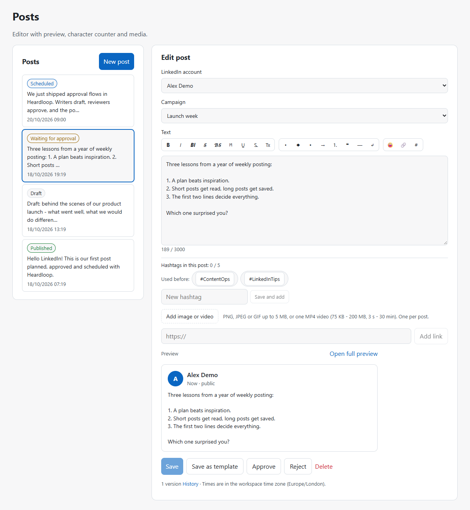
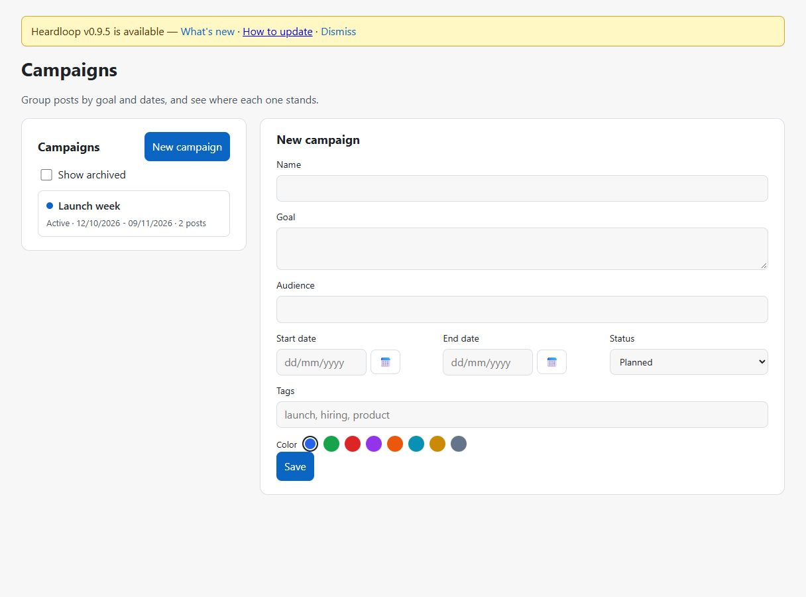
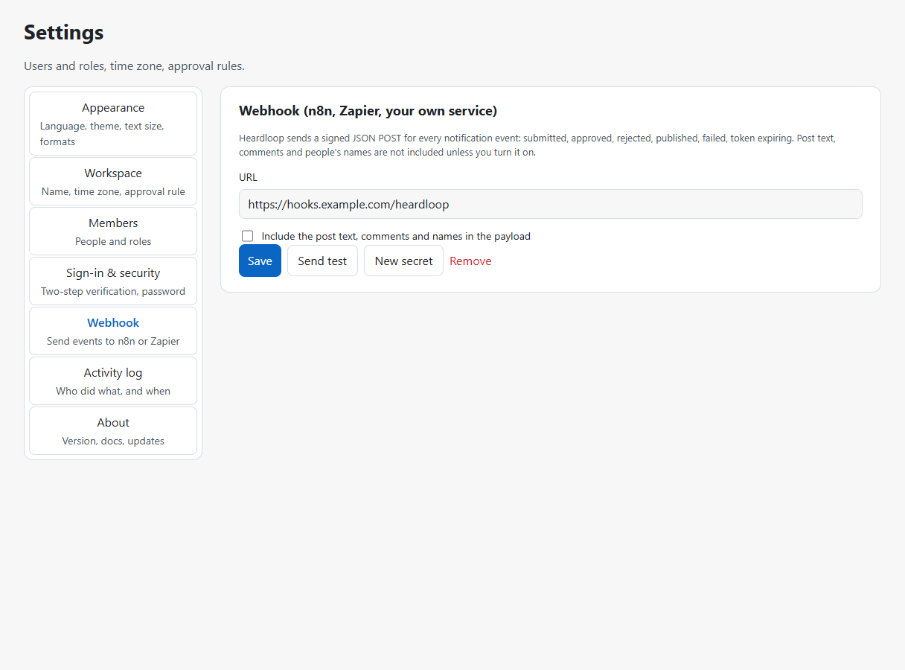
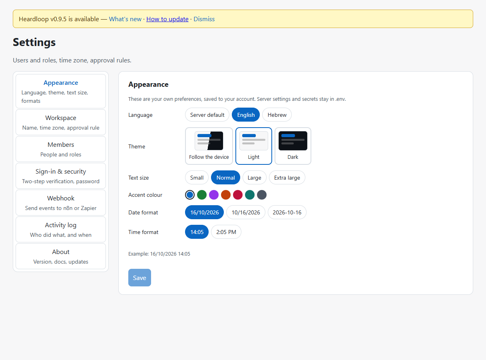
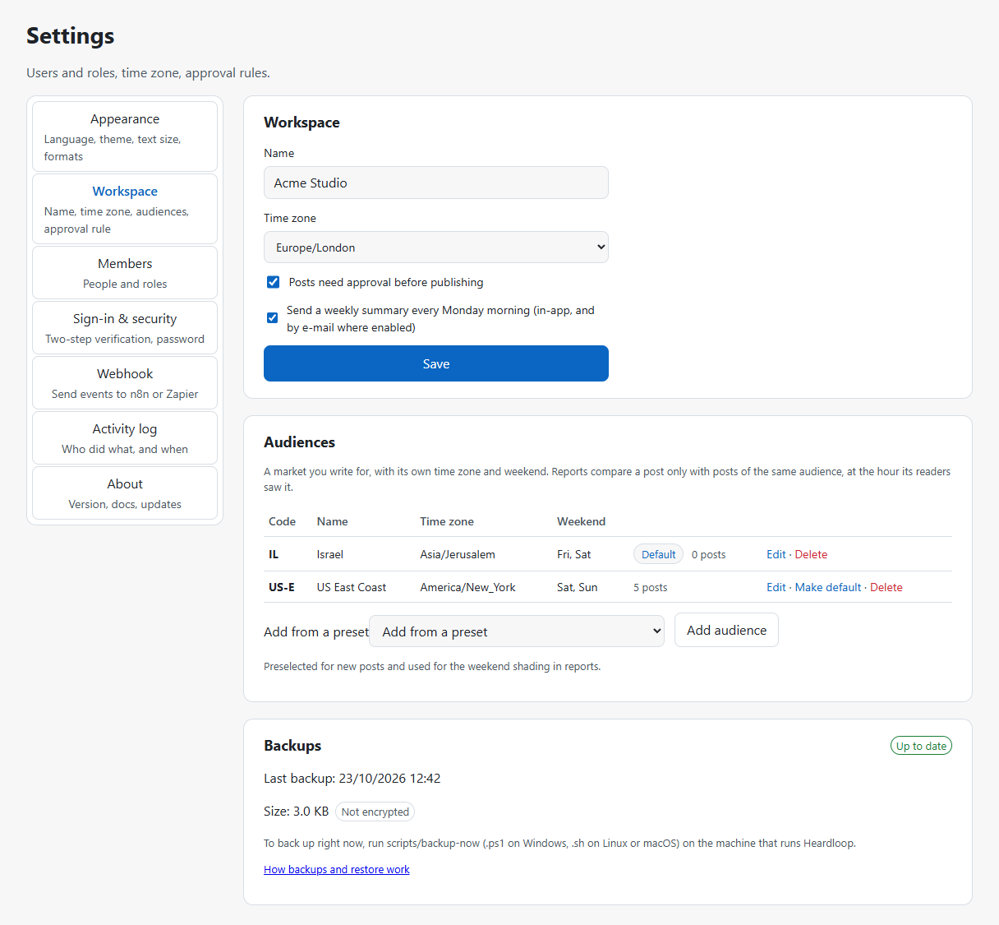
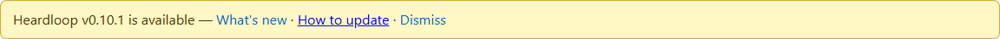

# Heardloop user guide

Heardloop is a self-hosted workspace for planning, approving, scheduling and publishing LinkedIn posts.
This guide walks through everyday use. Installation is in [INSTALL.md](INSTALL.md)
([Hebrew](he/INSTALL.md)); design decisions are in [SPEC.md](SPEC.md).

## 1. First sign-in

1. The owner account is created once with `create_owner` (see [INSTALL §7](INSTALL.md#7-create-the-owner-account)). There is no public sign-up.
2. Sign in at `http://localhost:8380`. Owners must turn on **two-step verification** before they can manage
   members, settings, LinkedIn accounts or the activity log: Settings → Sign-in & security → scan the QR code
   with an authenticator app, enter the code, and **store the recovery codes** somewhere safe.
3. Connect a LinkedIn profile: Accounts → Connect. LinkedIn asks for permission once; the connection lasts about
   60 days and Heardloop reminds owners a week before it expires.

## 2. Roles

| Role | Can |
| --- | --- |
| Viewer | Read everything in the workspace |
| Editor | Write posts, upload media, manage campaigns and hashtags |
| Approver | Everything an editor can, plus approve or send back posts |
| Owner | Everything, plus members, settings, LinkedIn accounts, webhook, activity log (two-step verification required) |

## 3. Writing a post

Posts → **New post**.

- **Account**: the LinkedIn profile that will publish.
- **Campaign** (optional): groups the post with others; changing it never resets a post's approval.
- **Text**: plain text, exactly what LinkedIn receives. The toolbar offers:
  - *Bold, italic, script, monospace*: these swap Latin letters and digits for look-alike Unicode characters.
    LinkedIn has no real formatting, so this is the only way. Hebrew and other scripts have no such characters
    and stay as they are. Use it for a heading or a phrase: screen readers spell styled text letter by letter
    and search does not match it. The editor warns when more than a fifth of the text is styled.
  - Underline and strikethrough (combining marks; some phones show them unevenly).
  - Bullets, numbering, quote, separator line, blank line, emoji.
  - **Link**: LinkedIn cannot attach a link to a word. The button inserts the address after the selected text;
    LinkedIn turns the address into a clickable link.
  - **RLM** (Hebrew): fixes a line that starts with a number or a Latin word.
  - **Tx** removes all formatting from the selection (or the whole post).
- **Counter**: characters as LinkedIn counts them (limit 3,000). Styled letters count double on some platforms;
  the number in brackets is the conservative figure.
- **Hashtags**: the ones already in the post are counted against LinkedIn's guidance of 3–5. Click a saved or
  recently used tag to add or remove it; save new tags to the workspace library.
- **AI assistant** (optional, only when the owner set it up, see [INSTALL section 13](INSTALL.md#13-optional-ai-writing-assistant)):
  improve, shorten, stronger opening, fix spelling, suggest hashtags, or translate to English or Hebrew, with an
  optional tone. It works on the selected text, or on the whole post when nothing is selected. The answer is a
  suggestion: **Replace**, **Insert below** or **Discard**. Suggested hashtags are added with a click. The text is
  sent to the AI server the owner configured; nothing is stored.
- **Image or video**: one PNG/JPEG/GIF up to 5 MB, or one MP4 (75 KB–200 MB, 3 s–30 min). Videos are uploaded
  to LinkedIn in the background when the post goes out and may take a few minutes to process.
- **Link card**: paste an address and **Add link**; the title and description are fetched from the page and can
  be edited. The post image becomes the card thumbnail. A post is either a video or a link card, not both.
- **Preview**: the card on the right shows the post as LinkedIn renders it, including the "see more" cut.
  **Open full preview** shows it at desktop or phone width.
- **From template** (new posts only): pick a workspace template; built-in placeholders are filled, and any
  custom ones stay highlighted until you replace them. Save is refused in the browser while any remain.
- **History**: next to the version count, open the history panel to compare an older version (word-level
  diff) and restore it when the post is editable. Restore creates a new version; scheduled posts must be
  unscheduled first. At most 200 newest versions are listed (older ones stay in the database).


- **Save as template**: on an existing post, copy the current text and link card into a new template
  (media is not copied).


Every save creates a version. Editing a post that was already approved or scheduled sends it back to draft.

## 4. Approval and scheduling



The life cycle is: Draft → Waiting for approval → Approved → Scheduled → Publishing → Published (or Failed).

- When the workspace requires approval (Settings → Workspace), editors **submit** a post; approvers and owners
  **approve** or **send back** with a comment, from the post itself or from the **Approvals** queue.


- **Schedule** a post for a date and time in the workspace time zone, or **Publish now**. The worker publishes
  within about 15 seconds of the time and never publishes a post twice: if the outcome is unknown (for example a
  network failure mid-call), the post is marked failed and you are asked to check LinkedIn before retrying.
  LinkedIn's API terms restrict automated posting; see [LinkedIn's terms](../README.md#linkedins-terms) in the
  README for how Heardloop's scheduled publishing relates to them.
- **Best times** next to the scheduling field: up to three weekday + hour slots whose posts had the best
  engagement rate in your own metrics (last 180 days, workspace time zone). A click puts the next such time in
  the field. They appear once at least five posts have numbers and a slot has two posts; no AI is involved.
- The **Calendar** shows scheduled and published posts by month or week. Drag a scheduled post to another day to
  move it (same time of day).


**When a post fails:** you get a notification with a plain-language reason; the activity log records the outcome
(system actor); and if the LinkedIn account must be reconnected, Accounts shows an amber banner. After you
reconnect, Accounts can offer to reschedule the failed posts for that account (about one minute ahead).

## 5. Campaigns

Campaigns → **New campaign**: name, goal, audience, dates, tags and a colour. The colour marks the campaign's
posts in the calendar. Each campaign shows how many posts it has in each status. Archived campaigns are hidden by
default and accept no new posts; a campaign with posts cannot be deleted, archive it instead.



## 5a. Templates

Templates → **New template**: a reusable starting point for posts (text, link card, tags, optional campaign).
No media. In the body you can use placeholders:

| Placeholder | Filled when you use the template |
| --- | --- |
| `{{name}}` | Your display name |
| `{{date}}` | Today's date in the workspace time zone (ISO; the editor formats it for you) |
| `{{campaign}}` | The template's campaign name, or empty |
| `{{link}}` | The template's link URL, or empty |
| `{{custom_word}}` | Left as-is; listed so you can replace it in the post editor |

Using a template does not create a post: it prefills a new draft. Templates that have been used cannot be
deleted (archive them instead). Names are unique among active templates in the workspace.


## 6. Metrics and reports


LinkedIn does not give this app read access to your post analytics, so numbers are entered by hand, and it takes
a minute per post: open a published post in Heardloop, click **Add measurement** under the preview, copy the
numbers from the post's analytics on LinkedIn (impressions, reactions, comments, reposts, clicks, saves, and your
follower count that day) and save. Add a new measurement whenever you check again, for example after a day, a
week and a month; the latest one is used in reports and the history shows how the post grew.

Typing is not the only way: LinkedIn lets you export a post's analytics as an `.xlsx` file (open the post on
LinkedIn, then **Analytics**, then **Export**). Heardloop reads the numbers from that file, and the file itself is
not kept. Two ways to import it:

- **From the post**: under the preview of a published post click **Import LinkedIn export**, optionally set the day
  the numbers were captured, and choose the file. The measurement is added to the history with its source shown as
  "LinkedIn export", together with members reached, profile viewers, followers gained, sends and an expandable
  **Audience** block (the top three values per category and the top job title, location and industry).
- **In bulk from Reports**: click **Import exports** and drop one or several files. Each file is matched to its post
  by the post id inside the file (the number in the file name is not the post id) and the result of every file is
  listed.

LinkedIn offers two file layouts; both are understood. The publish time in the first layout is UTC, in the second
it is local time, which Heardloop reads in your workspace time zone. Importing the same file again for the same
day is skipped ("already imported").

If the export belongs to a post that was not published through Heardloop, you are asked whether to import it as a
new post. Choose the LinkedIn account that published it and, if you like, paste the post text (the file has none);
the post is created as already published, marked **imported** in the post list, and counts in every report.
A post created without text shows "Text not available - paste it from LinkedIn"; open it and paste the original
text, then save. The post stays published (nothing is sent to LinkedIn); only its text and campaign can be changed.

**Reports** shows a period (30/90/180/365 days or custom), optionally one campaign: totals, a week-by-week
trend, the strongest posts, and how posts perform by campaign, day of week, hour of publishing and media type.
Posts published without metrics are listed so you can fill them in. **Export CSV** gives one row per post for a
spreadsheet.

Every Monday morning the **weekly digest** (in-app and by e-mail where enabled) sums up last week: published,
scheduled this week, waiting for approval, the strongest recent post and how many posts still need metrics.
Owners can switch it off in Settings → Workspace.

## 7. Notifications

The bell shows unread notifications: a post waiting for your approval, your post approved or sent back (with the
comment), published, or failed, a LinkedIn connection about to expire or that needs reconnecting, and (for owners)
an overdue or failed backup. Each person can also receive them by
e-mail (Settings → Notifications, when the server has SMTP configured).

Owners can send every event to a **webhook** (Settings → Webhook) for n8n, Zapier or their own service. Each call
is signed; see [WEBHOOKS.md](WEBHOOKS.md) for the payload and how to verify the signature.



## 8. Settings

- **Appearance** (per person): language, light/dark theme, text size, accent colour, date and time format.


- **Workspace**: name, time zone, whether posts need approval, weekly digest on/off. Owners also see the
  **Backups** card (see section 10).
- **Members**: add people with an initial password they must change (they get no e-mail notifications until they
  switch them on), set roles, remove people. **Deactivate and anonymise** (owners, confirmed with a two-step code)
  closes a member's account for good: the name becomes "Former member", sign-in, sessions, notifications and
  stored connections are removed, and the activity log keeps showing what they did under that name.
- **Sign-in & security**: two-step verification and recovery codes, change your password (the new one must
  differ from the current one).
- **Webhook** (owners): outgoing events. Names of people and accounts are sent only when "Include the post text"
  is on. A plain `http://` address on the internet shows a warning (the payload would travel unencrypted);
  `http://` to n8n on your own network is fine.
- **Activity log** (owners): who did what and when, with filters by type, person, date and free text. Owners
  can clear the log (all, or entries older than a date) after re-entering their password. Wrong passwords there
  count toward the same sign-in lockout (5 failures lock the account for 15 minutes) and are logged; the
  clearing itself is recorded.
- **About**: the running version, build id, licence (MIT), links to the install guide, this guide, webhooks and
  the n8n example (Hebrew links when the UI is Hebrew). Owners also see whether a newer release is available
  and can run **Check now**. The app never installs updates itself.

## 9. Good to know

- All times are stored in UTC and shown in the workspace time zone; times that do not exist or happen twice on a
  clock-change day are rejected when scheduling.
- A recovery code is used up only when it signs you in (or disables two-step verification); a request that fails
  for another reason leaves it valid.
- Expired sign-in sessions are cleaned up hourly. Uploads that no post uses are deleted after 24 hours, together
  with stray files on the media volume, so attach an upload to a post the same day.
- Names, goals, audiences and notes cannot contain control characters (line breaks are fine only in goals,
  audiences and notes).
- The API is not published on the host: everything goes through the web address (see the
  [README Development](../README.md#development) section for the override, and
  [Exposing Heardloop beyond localhost](../README.md#exposing-heardloop-beyond-localhost)).
- Secrets (database password, encryption key, LinkedIn app, SMTP) live only in `.env`. Back up
  `HEARDLOOP_TOKEN_KEY`: without it the stored LinkedIn tokens and two-step secrets cannot be read.
  If the LinkedIn connection shows "needs reconnecting" right after a restart, check that
  `HEARDLOOP_TOKEN_KEY` in `.env` did not change (the server refuses to start on a mismatch).
- Heardloop uses only LinkedIn's official API and never scrapes LinkedIn. It is not affiliated with LinkedIn.

## 10. Backups and restore

Every night the `backup` service writes a verified copy of the database and the media files to a folder on the
machine that runs Heardloop. Nothing to switch on: it starts with the stack.

**What is backed up**

- The **database** (posts, versions, campaigns, metrics, members, settings, activity log).
- The **media** volume (uploaded images and videos).

**What is NOT backed up: `.env`.** It holds the database password, your LinkedIn app secret and
`HEARDLOOP_TOKEN_KEY`, and a backup that carried them would defeat their purpose. **Keep your own copy of `.env`
(at least `HEARDLOOP_TOKEN_KEY`) somewhere safe, away from the backup folder.** Without the original
`HEARDLOOP_TOKEN_KEY`, the LinkedIn tokens and two-step verification secrets inside a restored database cannot be
read: you would reconnect LinkedIn accounts and owners would need new recovery codes. If you set a backup
passphrase (below), store it next to `HEARDLOOP_TOKEN_KEY`: an encrypted backup is useless without it.

**Where, when, how long**

| Setting (in `.env`) | Default | Meaning |
| --- | --- | --- |
| `BACKUP_DIR` | `./backups` | Folder for the backup files (next to `docker-compose.yml`, git-ignored) |
| `BACKUP_HOUR_UTC` | `01` | Hour of the nightly run, in UTC |
| `BACKUP_KEEP_DAYS` | `30` | Sets older than this are deleted... |
| `BACKUP_KEEP_MIN` | `7` | ...but this many successful sets always stay, and the newest good one is never deleted |
| `BACKUP_PASSPHRASE` | empty | Optional. If set, the files are encrypted (AES-256, key derived with PBKDF2, 600,000 rounds) |

Each run makes one **set** named `heardloop-YYYYMMDDTHHMMSSZ`: `.dump` (database), `-media.tar.gz` (media; a
`.enc` suffix is added when encrypted), `.sha256` (checksums), `.json` (what happened) and `latest.json` (a copy
of the newest result). The service reads the database dump and the media archive back before it calls the set
good, and records a failed run too. The database and the media are copied one after the other, not at the same
instant: a post uploaded during the few seconds of a backup may be in one and not the other.

Changing `BACKUP_PASSPHRASE` only affects later backups; older sets need the passphrase they were made with.
Encryption protects the files at rest; use a long passphrase. On Linux the backup user (uid 70) must be able to
write to `BACKUP_DIR`: `mkdir -p backups && sudo chown 70 backups` before the first start. Backup files are
private to that user, so copy them with `sudo` there; on Windows and macOS Docker Desktop shows them as yours.

**Back up right now**

```powershell
powershell -ExecutionPolicy Bypass -File scripts/backup-now.ps1
```

```bash
bash scripts/backup-now.sh
```

It prints the set, its size and whether it succeeded.

**Restore, step by step**

A restore **replaces** the current database and media files with the ones in a set. Do not try it on a stack you
cannot afford to lose without a fresh backup of it first.

1. Put the original `.env` (the same `HEARDLOOP_TOKEN_KEY`) in place. For an encrypted set, make the passphrase
   available: set `BACKUP_PASSPHRASE` in `.env`, or in your shell for this one command
   (`$env:BACKUP_PASSPHRASE = '...'` in PowerShell, `export BACKUP_PASSPHRASE=...` in bash).
2. Pick a set name from the files in `BACKUP_DIR` (for example `heardloop-20261018T010000Z`).
3. Run the script. It asks you to type `yes`, stops `api` and `worker`, restores the database and the media, and
   starts them again:

   ```powershell
   powershell -ExecutionPolicy Bypass -File scripts/restore.ps1 heardloop-20261018T010000Z
   ```

   ```bash
   bash scripts/restore.sh heardloop-20261018T010000Z
   ```

4. Open `http://localhost:8380` and check your data.

Before it changes anything, the restore checks the checksums, decrypts, and reads both files; a damaged or
wrongly decrypted set is refused. The database is restored in one transaction, so a failure leaves the old data in
place. Done by hand, the same thing is (the `restore` service mounts the media volume read-write and runs as root
with three capabilities, so it can write files that belong to the application user; `docker compose up` never
starts it):

```powershell
docker compose stop api worker
docker compose run --rm -e CONFIRM_RESTORE=yes restore heardloop-20261018T010000Z
docker compose start api worker
```

```bash
docker compose stop api worker
docker compose run --rm -e CONFIRM_RESTORE=yes restore heardloop-20261018T010000Z
docker compose start api worker
```
Without `CONFIRM_RESTORE=yes` the restore refuses to run. It warns if other programs are still connected to the
database: stop `api` and `worker` first.

**Copy backups off the machine.** A backup on the same disk does not survive a dead disk or a stolen laptop. The
files in `BACKUP_DIR` are self-contained: point any folder sync, cloud drive or external-disk copy at that folder
(or copy the newest set by hand). With a passphrase set, the copies are safe to store in a cloud drive.

**The Backups card** (Settings → Workspace, owners): when the last backup finished, its size, whether it is
encrypted, and a colour. **Green**: the last backup succeeded less than 36 hours ago. **Amber**: it is 36 hours
old or older (the service is stopped, or the machine was off). **Red**: the last run failed, or its status file
cannot be read; the reason is shown, and `docker compose logs backup` has the details. When a backup is amber or
red, every owner gets one notification a day (in-app, by e-mail where enabled, and to the webhook as
`backup.stale` or `backup.failed`) until it is green again. If no backup exists 36 hours after the stack started,
that counts as amber.



## 11. Updating

Owners may see a banner when a newer GitHub release is available (Settings → About has the same status and a
**Check now** button). Heardloop never installs an update from the browser: that would need the Docker socket
inside a web-facing container. On the host, after a backup, run `scripts/update.ps1` (Windows) or
`scripts/update.sh` (Linux/macOS). Full steps: [INSTALL §11](INSTALL.md#11-backups-and-updates).


