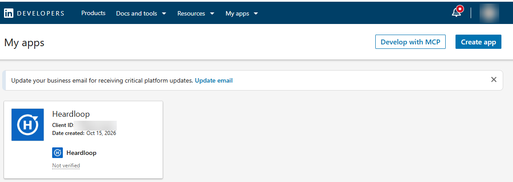
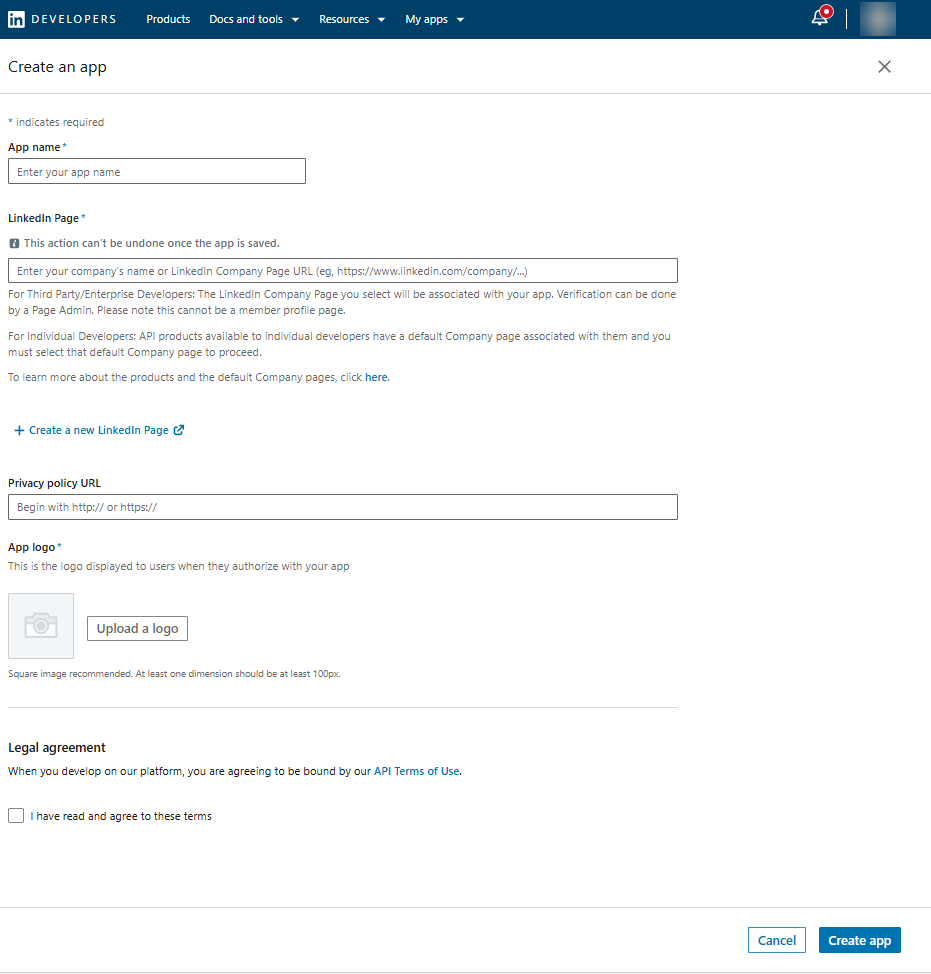
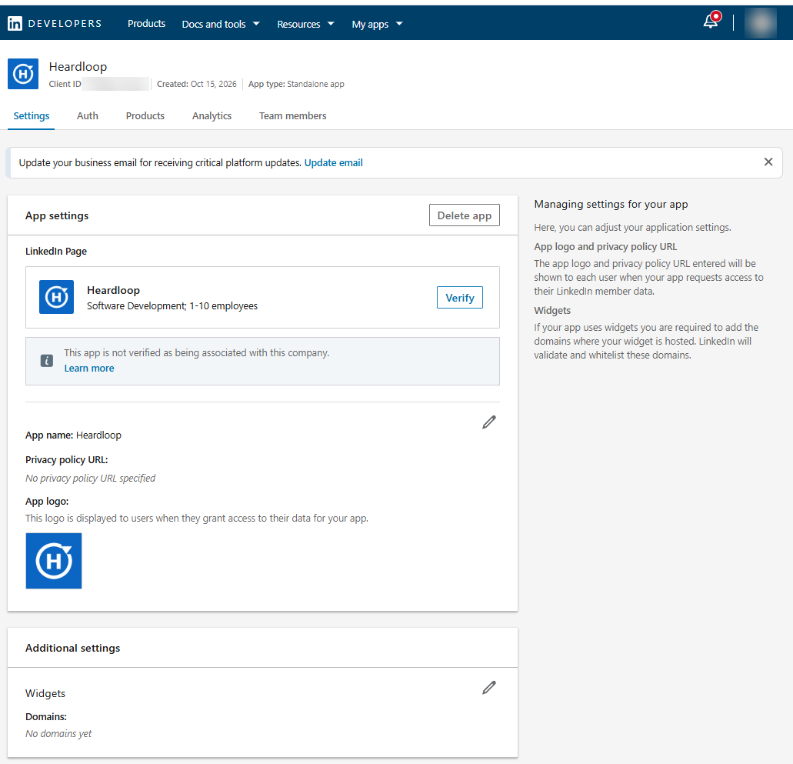
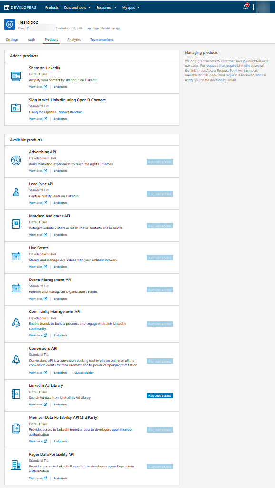
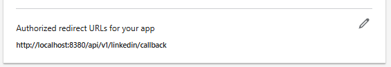
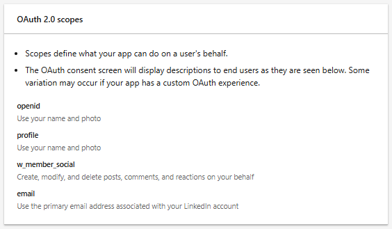
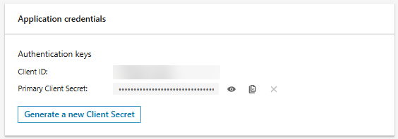
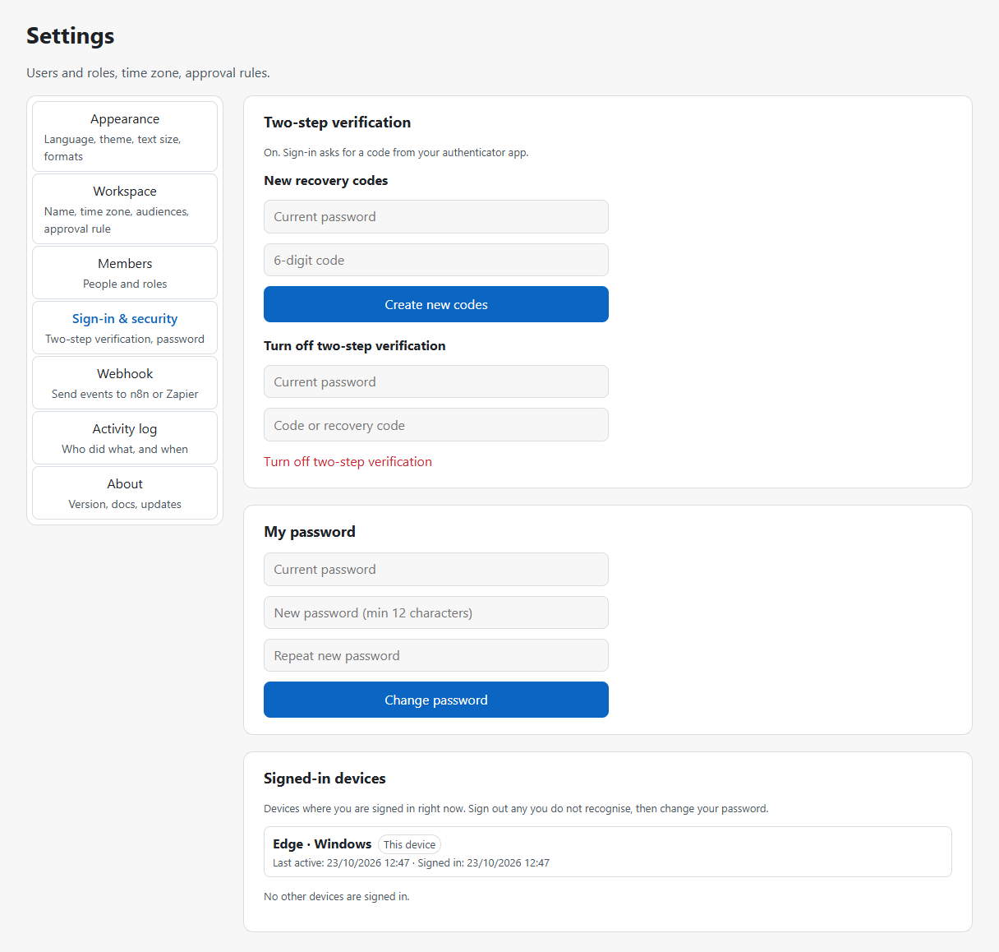
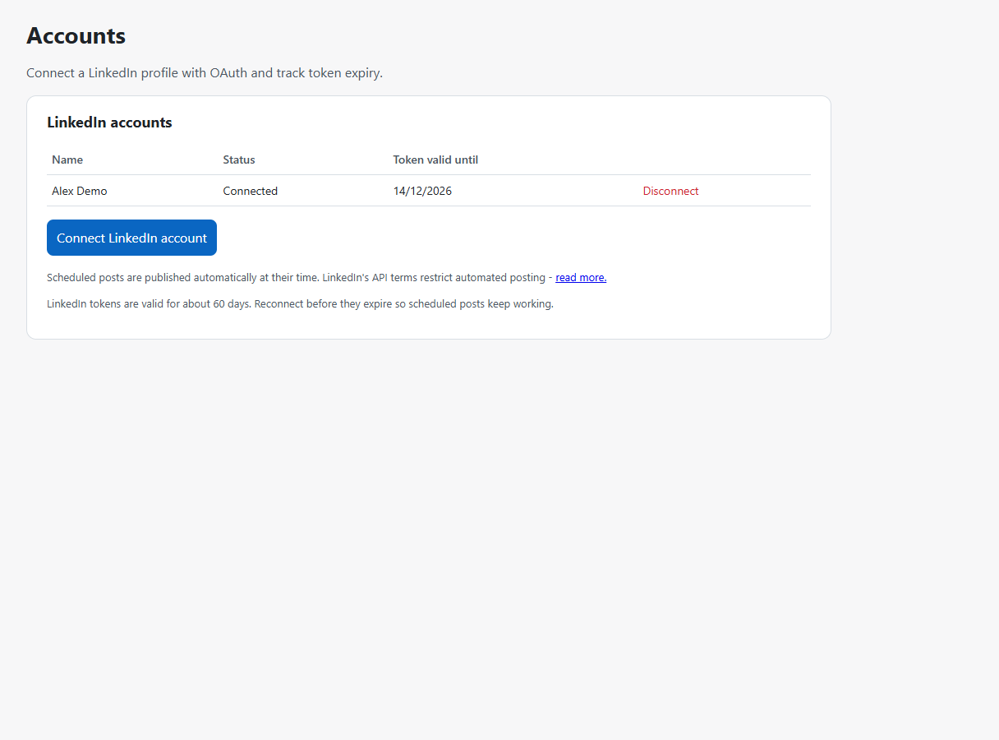

# Installation guide

This guide takes you from an empty computer to your first scheduled LinkedIn post. Allow about 30 minutes.
Every command is shown for Windows PowerShell; Linux and macOS use the same commands with `.sh` scripts.

> Hebrew version: [docs/he/INSTALL.md](he/INSTALL.md)

> **Faster:** `scripts/install.sh` (Linux/macOS) and `scripts/install.ps1` (Windows) do sections 1-3 and 5-7 for
> you, including Docker. See [Quick start](../README.md#quick-start). This guide is the manual way and the reference.

**Contents**

1. [What you need](#1-what-you-need)
2. [Get Heardloop](#2-get-heardloop)
3. [Create the secrets file](#3-create-the-secrets-file)
4. [Create the LinkedIn developer app](#4-create-the-linkedin-developer-app)
5. [Put the LinkedIn keys in `.env`](#5-put-the-linkedin-keys-in-env)
6. [Start Heardloop](#6-start-heardloop)
7. [Create the owner account](#7-create-the-owner-account)
8. [First sign-in and two-step verification](#8-first-sign-in-and-two-step-verification)
9. [Connect your LinkedIn profile](#9-connect-your-linkedin-profile)
10. [Your first post](#10-your-first-post)
11. [Backups and updates](#11-backups-and-updates)
12. [Troubleshooting](#12-troubleshooting)

---

## 1. What you need

| Item | Notes |
| --- | --- |
| A computer that stays on when posts are due | Windows 10/11, macOS or Linux. Posts are published by your computer; if it sleeps, they go out when it wakes. |
| [Docker Desktop](https://www.docker.com/products/docker-desktop/) | Install, start it once, and wait until it says "Engine running". On Windows it asks to enable WSL 2: accept. |
| [Git](https://git-scm.com/downloads) | Used to download and update Heardloop. |
| A LinkedIn account | The profile you will post from. |
| A LinkedIn Page you administer | LinkedIn requires every developer app to be linked to a Page. Any small Page works; it is not where your posts go. |

Check Docker from PowerShell:

```powershell
docker --version
docker compose version
```

Both commands must print a version number.

## 2. Get Heardloop

Pick the folder where Heardloop will live (it keeps its files there), then:

```powershell
git clone https://github.com/HirezRa/heardloop.git
cd heardloop
git checkout v<latest>   # the newest version from the Releases page, for example v0.11.0
```

Using a release tag (not the `main` branch) means you run a tested version, and the in-app update notice works.

## 3. Create the secrets file

```powershell
powershell -ExecutionPolicy Bypass -File scripts/new-env.ps1
```

This creates `.env` with a random database password and a random encryption key
(`HEARDLOOP_TOKEN_KEY`). Linux/macOS: `bash scripts/new-env.sh`.

> **Back up `.env` now** (password manager or an encrypted USB stick). Without `HEARDLOOP_TOKEN_KEY` a restored
> backup cannot read the stored LinkedIn connections or two-step secrets. Never commit `.env`, never send it to
> anyone, and never set `HEARDLOOP_TOKEN_KEY` or `POSTGRES_PASSWORD` as a shell variable: a shell variable
> overrides `.env`, and Heardloop then refuses to start.

## 4. Create the LinkedIn developer app

Heardloop talks to LinkedIn through your own free developer app. Only you use it, and it never leaves your
computer. The screenshots below hide the real IDs; your screens show your own values.

### 4.1 Open the developer portal

Go to <https://www.linkedin.com/developers/apps> and sign in with the LinkedIn account you will post from.
Click **Create app**.



### 4.2 Fill in the app details

| Field | What to enter |
| --- | --- |
| **App name** | Anything you recognise, for example `Heardloop (personal)`. Members see it on the consent screen. |
| **LinkedIn Page** | Pick a LinkedIn Page you administer. If you are an individual developer, LinkedIn may require its default Company page for individual developers instead - follow the hint under the field. The choice cannot be changed after the app is saved. |
| **Privacy policy URL** | Optional. Leave empty for personal use. |
| **App logo** | Required. Any square image (PNG/JPG, at least 100 x 100 px). `docs/assets/logo.png` from this repository works. |
| **Legal agreement** | Read it and tick the box. |

Click **Create app**.



### 4.3 Verify the app with the Page (if asked)

On the **Settings** tab you may see "Verify" next to the Page. Click it, **Generate URL**, open that URL while
signed in as an administrator of the Page, and approve. The app shows "Verified" afterwards. Not every account
is asked to do this; if you do not see the button, skip this step.



### 4.4 Add the two products

Open the **Products** tab. Request access to both:

1. **Sign In with LinkedIn using OpenID Connect** - lets Heardloop know which profile it is posting for.
2. **Share on LinkedIn** - lets Heardloop publish posts (permission `w_member_social`).

For each: **Request access**, tick the terms, **Request access** again. Both are self-serve and are normally
approved immediately; they then appear under **Added products**.



Heardloop needs nothing else. You do **not** need the "Community Management API" or any marketing product.

> LinkedIn's API Terms of Use restrict automated posting (section 3.1). Heardloop publishes a post at the time a
> person scheduled it, using LinkedIn's official API and only the permission to post on behalf of the signed-in
> member; every post is written and scheduled by a person. Whether scheduled publishing fits your use of LinkedIn
> is your decision: read the [API Terms of Use](https://www.linkedin.com/legal/l/api-terms-of-use) and, if in
> doubt, ask LinkedIn. Prefer **Publish now** if you want every post by hand.

### 4.5 Add the redirect URL

Open the **Auth** tab. Under **OAuth 2.0 settings**, next to **Authorized redirect URLs for your app**, click the
pencil, then **Add redirect URL**, and enter exactly:

```text
http://localhost:8380/api/v1/linkedin/callback
```

Click **Update**. It must match character for character: `http`, `localhost`, port `8380`, no slash at the end.
If you changed the port or run Heardloop on another address, use that address and set `LINKEDIN_REDIRECT_URI` in
`.env` to the same value.



### 4.6 Check the scopes

Still on **Auth**, the **OAuth 2.0 scopes** section must list `openid`, `profile` and `w_member_social`
(`email` may be listed too; Heardloop does not request it). If `w_member_social` is missing, step 4.4 is not
finished.



### 4.7 Copy the Client ID and Client Secret

At the top of **Auth**, under **Application credentials**:

- **Client ID** - copy it.
- **Primary Client Secret** - click the eye icon, copy it.



> The Client Secret is a password for your app. Paste it only into `.env` (next step). Do not put it in chat,
> e-mail, screenshots or tickets. If it ever leaks: **Auth -> Generate a new Client Secret**, update `.env`,
> restart Heardloop.

## 5. Put the LinkedIn keys in `.env`

Open `.env` in a text editor (Notepad works) and fill in:

```dotenv
LINKEDIN_CLIENT_ID=<your Client ID>
LINKEDIN_CLIENT_SECRET=<your Client Secret>
LINKEDIN_REDIRECT_URI=http://localhost:8380/api/v1/linkedin/callback
```

Save the file. Leave the other lines as they are.

## 6. Start Heardloop

```powershell
docker compose up -d --build
```

The first build takes a few minutes. Check that everything runs:

```powershell
docker compose ps
```

`db`, `api`, `worker`, `web` and `backup` should be `running` (`api` and `db` also `healthy`).

## 7. Create the owner account

Once, for the first person:

```powershell
docker compose exec api python -m heardloop.devtools.create_owner --email <your-email> --name "<your name>" --workspace "<workspace name>"
```

Optional: `--time-zone Europe/London` (any IANA name). If omitted, Heardloop uses the host's local zone when it
is a known IANA name, otherwise `UTC`. New workspaces default to `UTC` when created without a flag.

It asks for a password (at least 12 characters) and never shows it. There is no public sign-up: the owner adds
other people later in **Settings -> Members**.

## 8. First sign-in and two-step verification

1. Open <http://localhost:8380> and sign in.
2. **Settings -> Sign-in & security -> Turn on two-step verification.** Scan the QR code with an authenticator
   app (Microsoft Authenticator, Google Authenticator, 1Password, ...), type the 6-digit code, confirm.
3. **Save the recovery codes** somewhere safe. Each works once if you lose your phone.

Owners cannot manage members, LinkedIn accounts, the webhook or the activity log until two-step verification is
on.



Optional, same screen: **Settings -> Appearance** for language (English/Hebrew), dark mode, text size and date
format.

## 9. Connect your LinkedIn profile

1. **Accounts -> Connect LinkedIn.**
2. LinkedIn shows the consent screen with your app name. Check it is your profile and click **Allow**.
3. You are back in Heardloop; the account shows **Active** and the date the connection expires.



LinkedIn connections last about 60 days. Heardloop reminds owners 7 days before; reconnecting takes the same two
clicks and keeps all your posts.


## 10. Your first post

1. **Posts -> New post.** Choose the account, write the text, optionally add an image, video or link card.
2. The preview on the right shows how LinkedIn will display it, including where "...see more" cuts the text.
3. **Save**, then **Schedule** a date and time (workspace time zone) or **Publish now**.
4. Within about 15 seconds of the time, the post is live; you get a notification with a link to it.


The [user guide](GUIDE.md) covers approvals, campaigns, the calendar, templates, metrics, reports and imports.

## 11. Backups and updates

- **Backups** run every night into the `backups` folder (setting `BACKUP_DIR`). **Settings -> Workspace ->
  Backups** shows the last one. Run one now with `scripts/backup-now.ps1`. Restoring is described in the
  [user guide, section 10](GUIDE.md#10-backups-and-restore).
- **Updates**: when a new version is published, owners see a notice in the app with what changed. To install it:

  ```powershell
  powershell -ExecutionPolicy Bypass -File scripts/update.ps1
  ```

  The script makes a backup first, downloads the new release, rebuilds and restarts, and checks that Heardloop
  comes back healthy. It never touches `.env`. Add `-VerifyTag` (or set `HEARDLOOP_VERIFY_TAG=1`; `--verify-tag`
  for `update.sh`) to refuse a release tag that has no valid signature from a key your git trusts; nothing is
  changed when the check fails.

## 12. Troubleshooting

| You see | Cause and fix |
| --- | --- |
| LinkedIn says **"The redirect_uri does not match the registered value"** | The address in step 4.5 differs from `LINKEDIN_REDIRECT_URI` in `.env`. Make them identical (no trailing slash), then `docker compose up -d`. |
| Heardloop says **"LinkedIn did not grant posting permission" (`missing_scope`)** | **Share on LinkedIn** is not added (step 4.4). Add it, then connect again. |
| LinkedIn shows **"unauthorized_scope_error"** | One of the two products is missing or still pending (step 4.4). |
| **Connect LinkedIn** is greyed out | `LINKEDIN_CLIENT_ID` / `LINKEDIN_CLIENT_SECRET` are empty in `.env`, or the stack was not restarted after editing it. |
| A post failed with **"needs reconnecting"** | The connection expired or was revoked. **Accounts -> Connect** again, then use **Reschedule failed posts** on the same screen. |
| Heardloop does not start, log says **"HEARDLOOP_TOKEN_KEY does not match"** | `.env` was replaced or a shell variable overrides it. Restore your backed-up `.env`; in PowerShell run `Remove-Item Env:HEARDLOOP_TOKEN_KEY` and start again. |
| **http://localhost:8380** does not open | Docker Desktop is not running, or another program uses port 8380. `docker compose ps` shows what runs; change the port in `docker-compose.override.yml`. |
| A scheduled post went out late | The computer was asleep or off at that time. Posts are published when it is back. |
| About says **Could not check for updates** with a TLS / certificate reason | A proxy or antivirus is inspecting HTTPS. Export your organisation's root CA to a `.pem` file, mount it read-only into the API and worker containers, and set `EXTRA_CA_CERT_FILE` to that path inside the container (see below). Do **not** turn off certificate verification. |

**Organisation CA for the update check (TLS inspection)**

1. Export the corporate root certificate as PEM (often "Base-64 encoded X.509 (.CER)" in Windows; rename/ensure it is PEM text starting with `BEGIN CERTIFICATE`).
2. Put the file next to `docker-compose.yml`, for example `certs/org-root.pem` (keep it out of git).
3. In `docker-compose.override.yml` (git-ignored), mount it and leave the env var pointing at the container path:

```yaml
services:
  api:
    volumes:
      - ./certs/org-root.pem:/certs/org-root.pem:ro
    environment:
      EXTRA_CA_CERT_FILE: /certs/org-root.pem
  worker:
    volumes:
      - ./certs/org-root.pem:/certs/org-root.pem:ro
    environment:
      EXTRA_CA_CERT_FILE: /certs/org-root.pem
```

4. `docker compose up -d` and use **Settings → About → Check now**. Only the GitHub update check uses this CA; LinkedIn, SMTP and webhooks keep the default trust store.

Still stuck? Open an issue on GitHub with the error text from the app or from `docker compose logs api worker`
(check that the text contains no e-mail addresses, tokens or IP addresses before posting it).

## 13. Optional: AI writing assistant

The post editor can show an **AI assistant** (improve, shorten, stronger opening, fix spelling, suggest hashtags,
translate). It stays off until you point Heardloop at a server that speaks the OpenAI-compatible
`/v1/chat/completions` API (Ollama, LM Studio, vLLM and others do). When someone uses it, the post text (or the
selected part) is sent to that server; Heardloop stores nothing. Prefer a model you run yourself, so the text
never leaves your network.

Example: Ollama as an extra service in `docker-compose.override.yml` (git-ignored):

```yaml
services:
  ollama:
    image: ollama/ollama:<version>   # pin a release tag
    restart: unless-stopped
    volumes:
      - ollama:/root/.ollama
volumes:
  ollama:
```

```powershell
docker compose up -d ollama
docker compose exec ollama ollama pull llama3.1:8b
```

Then in `.env`:

```dotenv
AI_BASE_URL=http://ollama:11434/v1
AI_MODEL=llama3.1:8b
```

and `docker compose up -d api`. A model of this size needs several GB of free memory and answers in seconds to
a minute on a normal PC; `AI_TIMEOUT_SECONDS` (default 60) is the limit per request.

- Ollama on another machine in your network: `AI_BASE_URL=http://<that machine>:11434/v1`.
- A hosted service also works (`AI_API_KEY` is sent as a Bearer token), but then post text leaves your network.
- Each person can send 10 requests a minute. Viewers do not see the assistant.

**Best times** next to the scheduling field need no AI: they come from your own post metrics (section 6 of the
[user guide](GUIDE.md#6-metrics-and-reports)) and appear once a few posts have numbers.
